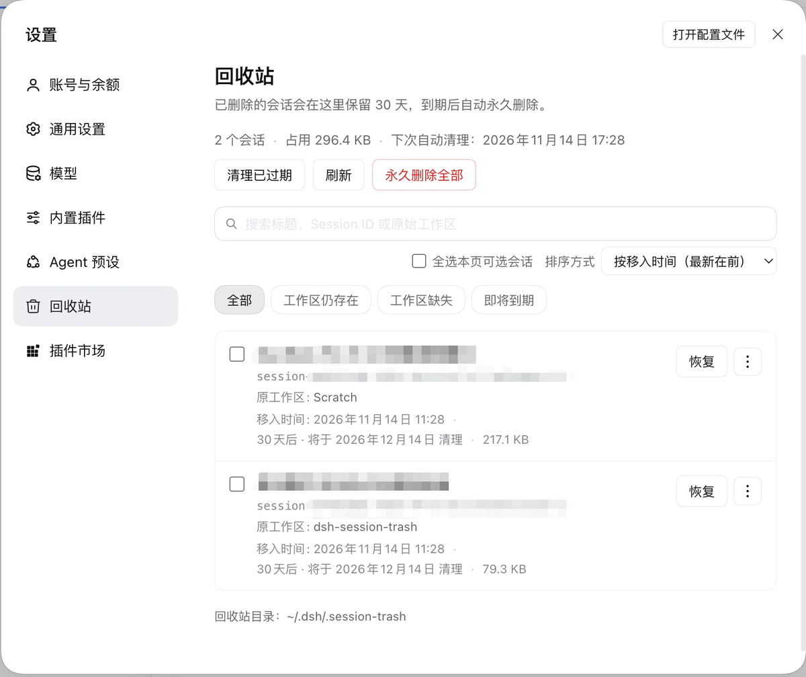

<p align="center">
  
</p>

<h1 align="center">dsh-session-trash</h1>

<p align="center">A session trash for DeepSeek Harness. Move cold sessions out of the sidebar, keep the logs local, and restore them within the retention window.</p>

<p align="center">
  <a href="https://github.com/wangxiaocuo/dsh-session-trash/actions/workflows/ci.yml"></a>
  <a href="https://www.npmjs.com/package/@wangxiaocuo/dsh-session-trash"></a>
  <a href="https://www.npmjs.com/package/@wangxiaocuo/dsh-session-trash"></a>
  
  
</p>

<p align="center"><a href="./README.md">简体中文</a> | English · <a href="https://github.com/wangxiaocuo/dsh-session-trash">GitHub</a> · <a href="./CHANGELOG.md">Changelog</a> · <a href="https://github.com/wangxiaocuo/dsh-session-trash/issues">Issues</a></p>

A sidebar collects sessions you talked to once. Deleting them feels wasteful, and keeping them clutters the sidebar.

This plugin adds a trash to DSH. Right-click a cold session to move it out of the sidebar; its log stays on disk. The Trash page in Settings lists those sessions, restores them within the retention window, and deletes the logs automatically when the window ends. If you are sure you no longer need one, delete it permanently.

Moving and restoring only touch the session directory; attachments and images stay where they are. Permanent deletion also removes the session's projection-cache record and workspace accounting, while attachments and images are kept. The index is committed atomically, so a process that dies mid-operation finishes or rolls back on the next startup.

<p align="center">
  
</p>

<p align="center"><sub>Settings → Trash. Search, filter, restore in bulk, or delete permanently.</sub></p>

## Features

### Trashing sessions

- Right-click a cold session in the sidebar and choose "Move to trash". A session with a running turn, job, subagent, or scheduled task cannot be trashed.
- Hidden subagent children move with their parent and come back with it.
- When a session cannot be trashed, the menu keeps a labelled explanatory item that opens and states the reason, instead of making the entry disappear.
- After the move, the shared DSH Toast offers one action: Undo. Undo tries a normal restore first and falls back to an orphan restore when the original workspace is gone.

### The Trash page

Settings, then Trash.

- Each row shows the conversation title, Session ID, original workspace, trashed date, remaining days, log size, and status. The row's "Log" figure covers session logs only, never attachments or images. The title is folded from the session log; entries written by earlier releases that stored the workspace name as the title are repaired from DSH's session-projection cache at startup.
- A line below the toolbar shows this device's session data: logs, attachments, and cache by category, plus the projection-cache bytes the startup sweep can reclaim. For attachments it also shows how many bytes are unreferenced (read-only scan; no file is deleted).
- Search, filters, and sorting by trashed date / title / size / expiry, with 50 rows per page.
- An entry with hidden children shows a "N child sessions" badge and expands to list each member with its title, Session ID, and size. Restore and permanent deletion cover the whole tree; there is no partial restore.
- Row actions are restore, restore as orphan, permanent deletion, removal from the index, copying the Session ID, and revealing the original workspace in Finder or Explorer.
- Select several entries to restore them as a batch (only rows whose workspace still exists), including a select-all-page checkbox.
- "Delete all permanently" in the toolbar empties the whole trash after one confirmation, including entries that have not expired.

### Automatic cleanup

- Entries are kept for 30 days by default, with a sweep every 6 hours; activation and opening the Trash page also trigger a check. Whether expired entries are deleted is controlled by `enableAutoCleanup`.
- Failed sweeps are retried with exponential backoff, and the page shows the failure.

### Reliability

- The index is committed atomically and the previous commit is kept as `.bak`. If both the index and the backup are unreadable, the plugin enters protection mode, refuses writes, and can rebuild from each object's `meta.json`.
- After a crash or power loss, unfinished `trashing`, `restoring`, and `purging` states are settled on the next startup, so a session log is never lost by accident.
- Multiple DSH processes sharing one `DSH_HOME` serialize writes through `.lock`; same-origin tabs sync through `BroadcastChannel`, with no focus change or manual refresh.

### Relationship to DSH's own menu

Rename, fork, archive, and copy Session ID stay in the shipped DSH sidebar menu. The plugin does not reimplement them.

## Installation

The plugin is published on npm ([`@wangxiaocuo/dsh-session-trash`](https://www.npmjs.com/package/@wangxiaocuo/dsh-session-trash)); the plugin dialog also accepts a GitHub address or a local directory.

It needs DSH `^0.2.2-rc.1` and Node.js 20 or newer, on Desktop or Web. Installation and removal use the current profile's pnpm. Desktop bundles pnpm; a `dsh web` started from source needs pnpm on `PATH`, and installing from GitHub also needs git and working access to GitHub.

### Install from DSH (recommended)

1. Open the **Plugins** panel in the sidebar and click **Add plugin**.
2. In **Package name or address**, enter `@wangxiaocuo/dsh-session-trash`. To install the latest code on the current branch, enter `git+https://github.com/wangxiaocuo/dsh-session-trash.git` instead.
3. Leave the **Registry** at its default. The plugin and its dependencies come from npm; on a slow network, switch to **Mainland China mirror**. The mirror can lag the official registry by a few minutes.
4. Click **Install**. DSH resolves the package name, description, and version, then runs pnpm. The command and output are under **Show install details**.
5. Click **Enable now** when it finishes. Restart DSH if prompted and refresh the page in the Web app. The context menu and the Trash settings page appear afterwards.

### Install from Git or a local directory

- A Git address must point at the repository root, for example `git+https://github.com/wangxiaocuo/dsh-session-trash.git`.
- For a local directory, clone the repository, run `pnpm install` in it (a directory-link bundle uses its own `node_modules`), then enter the absolute path of that directory.

### Let an agent install it

Ask the agent to run one of these. The operation needs `danger-full-access` or a separate approval.

```text
plugin_manager install_bundle  target=@wangxiaocuo/dsh-session-trash
plugin_manager install_bundle  target=git+https://github.com/wangxiaocuo/dsh-session-trash.git
plugin_manager install_bundle  target=/absolute/path/to/dsh-session-trash
```

Installing the directory saves a download when a clone already exists. With the DSH CLI installed, `dsh plugin add <the same spec>` is equivalent.

### Link into a profile manually (development)

```bash
git clone https://github.com/wangxiaocuo/dsh-session-trash.git
cd dsh-session-trash
pnpm install
```

```bash
cd "${DSH_HOME:-$HOME/.dsh}/profiles/desktop"
pnpm add link:/absolute/path/to/dsh-session-trash
```

Then add `@wangxiaocuo/dsh-session-trash` to `dsh.profile.bundles` in that profile's `package.json`, restart DSH to load the Host, and refresh the page to load the Client. Runtime dependencies are `@deepseek-ai/dsh-home-paths@0.2.2-rc.1` and `@deepseek-ai/schemastery@3.19.0`.

### Upgrade and uninstall

For an npm install, open Session trash on the Plugins panel and click **Update** in the **Versions** section; when no newer version is offered, uninstall and install again. A Git install only picks up new code after reinstallation. For a manual link, run `git pull` and `pnpm install` in the directory, restart DSH, then refresh the page.

To uninstall, open the same detail page, click **Uninstall**, and confirm; the profile dependency is removed. You can also remove it from the profile bundles and dependencies by hand and restart. Uninstalling does not delete `<DSH_HOME>/.session-trash`; delete that directory manually when its logs are no longer needed.

### Troubleshooting an install

Start with the pnpm output and the Host log path under **Show install details**.

- If it reports that no such plugin was found, check the spelling, wait for the mirror, or install from a Git address or local directory instead.
- If no registry can be reached, check the network or proxy, or install from a local directory.
- If it reports that the package declares no bundle, or that the path is not a valid plugin package, point the Git address at the repository root or enter the package directory itself.
- If the install finished but nothing shows up, make sure the bundle is enabled on the Plugins page; a profile without HMR needs a DSH restart, and the Web client needs a page refresh.

## Usage

Right-click a cold session and choose "Move to trash". After the Toast disappears, open the Trash page in Settings and restore it row by row or in a batch, or delete it permanently. When the original workspace directory is gone, the page asks for confirmation and restores the session as an orphan under "Ungrouped".

To empty the trash at once, use "Delete all permanently" in the toolbar and confirm; entries that have not expired are deleted too.

If the menu will not let you trash a session, check the [FAQ](#faq) first. Most often the session is still live, and restarting DSH is enough.

## Configuration

Configure the plugin row in the profile patch:

```yaml
- id: session-trash
  name: '@wangxiaocuo/dsh-session-trash'
  config:
    retentionDays: 30        # 1-3650
    sweepIntervalHours: 6    # 1-168
    enableAutoCleanup: true
    debug: false
```

| Field | Default | Range | Description |
|---|---|---|---|
| `retentionDays` | `30` | 1-3650 | Days a trashed session is kept before automatic deletion |
| `sweepIntervalHours` | `6` | 1-168 | Hours between automatic cleanup sweeps |
| `enableAutoCleanup` | `true` | boolean | When false, cleanup no longer deletes expired entries automatically |
| `debug` | `false` | boolean | Emit detailed diagnostic logs |

Defaults apply when `config` is omitted. Invalid values reject activation instead of falling back to defaults. Changing an ordinary field restarts the plugin.

## Storage and recovery

```text
<DSH_HOME>/.session-trash/
  trash-index.json          # authoritative index
  trash-index.json.bak      # previous committed index
  .lock                     # cross-process lock
  objects/
    <trashId>/
      meta.json             # object metadata
      session/              # the moved parent session directory
      children/
        <sessionId>/        # hidden subagent child directory moved along
```

The index is committed atomically with `tmp`, `fsync`, and `rename`, and the previous commit is kept as `.bak`. On activation and before every sweep, the plugin settles unfinished `trashing`, `restoring`, and `purging` entries. It completes what can be completed, rolls back what can be rolled back, marks uncertain cases as `missing`, and never deletes a session log during that recovery pass.

After a permanent deletion succeeds, the plugin removes `<DSH_HOME>/storages/session_projcache/sessions/<sessionId>.json` and drops the session from the workspace registry, including its archive and pin markers. Startup also sweeps projection-cache records older than seven days that no session can use. These cleanups are best-effort: a failure is logged, never rolls back a completed log deletion, and never blocks another entry.

A same-filesystem move uses `rename`. A cross-filesystem move copies into a temporary directory, verifies regular-file count and byte count, publishes with `rename`, then removes the source. Any failure cleans up the temporary directory and keeps the source. Symlinks are copied as symlinks, not followed.

On POSIX filesystems, the trash root uses `0700` permissions and the index and metadata files use `0600`. A lock older than 10 minutes is treated as stale.

The index schema is v2; a v1 index is upgraded automatically on startup and preserved as `.bak`. Older plugin releases cannot read v2 and enter protection mode, so empty the trash before downgrading.

## HTTP API

All routes live under `/plugins/dsh-session-trash/api/` and are registered as exact routes on `ctx.webServer`.

| Method | Path | Description |
|---|---|---|
| `GET` | `/state` | Config, index state, entries, stats, a storage breakdown, and cleanup diagnostics (read-only; never sweeps) |
| `POST` | `/sweep` | No body; runs one throttled page-open maintenance sweep; whether expired entries are deleted depends on `enableAutoCleanup` |
| `POST` | `/preflight` | `{ sessionId }` returns `{ eligible: true, descendants }` or `{ eligible: false, code, message, details? }`; `descendants` is the number of hidden children that move along |
| `POST` | `/trash` | `{ sessionId }`; moves the whole session tree (parent plus hidden subagent children) and returns `{ ok, entry }` |
| `POST` | `/restore` | `{ sessionId, mode: 'normal' \| 'orphan' }` |
| `POST` | `/purge` | `{ sessionId }`; permanently deletes the session log, its projection-cache record, and its workspace accounting; the response carries `freedBytes` |
| `POST` | `/purge-all` | No body; permanently deletes every entry in the trash, dropping `missing` index records only; returns `{ ok, purged, forgotten, failed, freedBytes }` |
| `POST` | `/forget` | `{ sessionId }`; removes only a `missing` index entry |
| `POST` | `/orphans/forget` | No body; removes empty unindexed object directories that hold no session log; returns `{ ok, removed }` |
| `POST` | `/reveal` | `{ sessionId }`; opens the original workspace |
| `POST` | `/cleanup` | No body; runs one cleanup sweep |
| `POST` | `/rebuild` | No body; rebuilds the index only in protection mode |

Requests must pass `ctx.connection.requestRejection()` and `ctx.connection.admit()`. `POST` requests also carry `X-DSH-Session-Trash: 1`. JSON bodies use `Content-Type: application/json` and are limited to 64 KiB. Responses use `Cache-Control: no-store` and never expose the absolute trash root.

Failures use `{ ok: false, error: { code, message, details? } }`. Preflight refusals include `SESSION_NOT_FOUND`, `ALREADY_TRASHED`, `SESSION_NOT_MATERIALIZED`, `STORAGE_UNSUPPORTED`, `SESSION_SUBAGENT`, `SESSION_HAS_DESCENDANTS`, `SESSION_LINEAGE_UNRESOLVED`, `SESSION_LIVE`, `SESSION_ACTIVE`, `UNSAFE_SESSION_DIR`, `INDEX_CORRUPT`, and `IO_ERROR`.

Restore and maintenance refusals include `TRASH_ENTRY_NOT_FOUND`, `TRASH_STATE_INVALID`, `TRASH_DIR_MISSING`, `RESTORE_TARGET_EXISTS`, `WORKSPACE_MISSING`, `RESTORE_VERIFY_FAILED`, `UNSAFE_RESTORE_PATH`, `FORGET_NOT_ALLOWED`, `REVEAL_UNAVAILABLE`, `REVEAL_FAILED`, `INDEX_CORRUPT`, `INDEX_NOT_CORRUPT`, `LOCKED`, and `IO_ERROR`.

`/state.stats.cleanup` reports the last cleanup attempt, the next sweep, a pending retry, consecutive failures, and the last run summary.

`/state.storage` breaks down this device's session data: `sessionLogs` (stored session logs), `trashLogs` (trashed logs), `attachments` (durable attachment objects), `attachmentCache` (regenerable request cache), `projectionCache` (record count and `sweepableBytes`), and `totalBytes`.

`attachments` carries `files`, `bytes`, `complete`, `referencedBytes`, `orphanBytes`, `unclassifiedBytes`, and `scan`. Every `/state` reconciles; the first one decompresses the logs: it performs a read-only scan of every session log (including logs inside the trash) for `sha256` references, then compares them with the object hashes under `attachments/v1`. `referencedBytes` and `orphanBytes` are published only when the scan is complete; otherwise both are `null` and `scan.status` is `partial` or `unavailable`. `complete: false` means the attachment directories could not be read in full, which also suppresses the orphan estimate. Per-file results are cached by size and mtime, so later requests only stat the logs.

**This release is read-only: it never deletes an attachment.** Reclamation and its confirmation flow belong to a later release. Without a zstd decoder in the Node runtime (roughly Node < 22.15), `scan.status` is `unavailable` and the page shows the attachment total only.

`/state` entries gain `subagentCount` (hidden children moved along) and `members` (parent first, each with `sessionId`, `origin`, and `sizeBytes`); `sizeBytes`/`fileCount` cover the whole tree. The `entry` returned by `/trash` uses the same shape. Entries also carry `lastErrorCode` (a stable category the page localizes) and `lastError` (the raw English diagnostic, used only as a tooltip).

## Limitations

- The current DSH version keeps an opened session live until the Host process exits. The context menu then shows the explanatory item instead of an actionable move; restart DSH before trashing it.
- Parent sessions with visible (non-subagent) children cannot be trashed on their own; archive the whole tree instead. Hidden subagent children move with their parent.
- A trashed tree is restored or deleted as a whole; there is no partial restore. If any member directory is missing, the entry is marked `missing` and can only be purged or forgotten.
- Orphan restore never recreates the original workspace directory and never reattaches the session to a workspace.
- Archive and pin state survive trash and restore. The Trash page does not manage either set.
- Permanent deletion removes the session log, its projection-cache record, and its workspace accounting (including archive and pin markers); a cleanup failure is logged and never rolls back an already-completed log deletion. Attachments and images are not deleted; the search index is derived data and DSH drops the deleted session on its next search.
- The attachment reference scan is a read-only estimate. It needs Node's zstd decoder (Node 22.15+) and only reads durable log tails; a log that is still being appended is counted in `scan.tornFiles`. Deleting attachments will rescan with a grace period; this release never deletes them.
- Unindexed objects (object directories whose `meta.json` is damaged or unreadable) are never deleted automatically; the page can only clean empty leftovers that hold no session log, and anything that may contain logs is left for manual inspection.
- `/state` returns all entry summaries and the storage breakdown in one response. Search, filtering, and paging happen in the Client.
- Same-origin tabs in the same browser sync index changes through `BroadcastChannel`; different browsers or machines still need a refresh.
- Batch restore only covers rows whose workspace still exists; entries with a missing workspace need an individual orphan restore.
- The desktop apps on Windows and Linux have not been verified manually; CI boots an npm-installed `dsh web` Host, so desktop-shell UI and desktop-only features (such as reveal in the file manager) are still verified on macOS only. On Windows, cases that rely on POSIX permission bits are skipped, and long paths over 260 characters / symlink copying depend on system configuration (the related tests skip themselves when unsupported).
- macOS path comparison is case-insensitive. On a case-sensitive APFS volume, paths that differ only by case are treated as the same location.
- Multiple DSH processes sharing one `DSH_HOME` serialize trash operations through `.lock`. The Host retries briefly before reporting `LOCKED`, and the Client retries once automatically; a process paused for more than 10 minutes can lose the lock to another process.

## FAQ

### Why is "Move to trash" missing from the context menu

The session is probably still live: it has been opened and the current Host process has not exited. It may also be running a turn, job, subagent, or scheduled task. Restart DSH and try again. A parent session with visible children should be archived instead.

### Does moving a session to the trash delete it

No. The session directory moves under `<DSH_HOME>/.session-trash/objects/` and stops showing in its workspace. You can restore it from the Trash page during the retention window; the log is deleted on expiry or on a manual permanent deletion.

### Does permanent deletion remove attachments and images

No. Attachments and images are content-addressed and may be shared by several sessions, so the plugin never deletes them per session. Permanent deletion removes the session log, its projection-cache record, and its workspace accounting; the search index drops the session on its next search. Global attachment reclamation is outside this release.

### How is the attachment "unreferenced" figure calculated

The plugin performs a read-only scan of session logs under `sessions/` and inside the trash, collects every `sha256` attachment ID they mention, and compares that set with the object hashes under `attachments/v1`. An object no session references counts as `orphanBytes`. A shared image still counts as referenced while at least one session mentions it. When the scan is incomplete the page says "reference scan incomplete" and publishes no orphan estimate. This release reports only; it does not delete.

Only session logs are considered: unsaved pastes, staged uploads, and copies kept by third-party memory or index plugins are not in the reference set, so the unreferenced figure is a conservative estimate. The deletion slice will rescan with a grace period.

### Why is the trash total smaller than disk usage

The toolbar's "Logs" figure counts only trashed session logs. Attachments, images, the projection cache, and the regenerable cache appear in the device-wide "Session data" line. Attachments are content-addressed and may be shared by several sessions, so the plugin never attributes a shared object's bytes to one row.

### Where does a restored session go

Back to its original workspace. If that workspace directory no longer exists, choose "Restore as orphan" and the session returns to "Ungrouped"; the workspace directory is not recreated.

### Can I keep the trash forever

Yes. Set `enableAutoCleanup` to `false` and expired entries are no longer deleted automatically. `retentionDays` still drives the remaining-days column, and manual permanent deletion keeps working.

### What happens with two DSH instances at once

The `.lock` file serializes writes to the trash. Live state is not shared between instances, so the other instance will not stop you; do not use it to bypass the check.

### Can I downgrade the plugin

The index schema is v2 and older releases cannot read it; they enter protection mode. Empty the trash before downgrading.

## Development

```bash
pnpm install
pnpm test          # unit tests + real-DOM component tests (jsdom)
pnpm typecheck     # tsc --checkJs (currently lib/ and index.js)
pnpm test:coverage # coverage (CI thresholds apply to lib/**)
pnpm test:smoke    # Host smoke test (real Cordis, plain Node)
npm run test:e2e   # real dsh web end-to-end (desktop app or npm-installed DSH)
```

The Host smoke test wires the plugin into a real Cordis context through the `@deepseek-ai/cordis` devDependency, creates its own temporary `DSH_HOME`, and removes it afterwards; it does not need the desktop app. Set `DSH_SMOKE_KEEP=1` to keep the temporary home for debugging. `pnpm test` enumerates the test files through `test/run-unit.mjs`, so it does not depend on shell glob expansion and behaves the same on Windows and POSIX shells.

The checks below run in CI; the last row is run by hand.

| Check | Verified environment |
|---|---|
| Unit tests, Host smoke test | CI covers Ubuntu Node 20/22, Windows Node 22 |
| Package contents (`npm pack`) | CI covers Ubuntu |
| Coverage thresholds (`lib/**`, lines 85 / branches 70 / functions 84) | CI covers Ubuntu Node 22 |
| Real `dsh web` end to end (npm-installed DSH) | CI covers Ubuntu, Windows (Node 22) |
| Real `dsh web` end to end (desktop app) | macOS + DSH 0.2.2-rc.1 (run manually) |

`npm run test:e2e` boots a real `dsh web` Host in a temporary `DSH_HOME` and runs the full flow. By default it discovers the desktop app in the platform's usual install locations (or uses `DSH_ELECTRON`); set `DSH_E2E_DSH_BIN` to the `lib/bin.js` of an npm-installed `@deepseek-ai/dsh` to boot the Host with plain Node instead, which is how CI and Linux/Windows run it, with no desktop app required. When no Host is found it prints a skip message and exits 0. The cleanup-failure scenario that relies on POSIX permission bits is skipped on Windows. Set `DSH_E2E_KEEP=1` to keep the temporary home and logs.

### Releasing (maintainers)

1. Bump the version in `package.json` and update `CHANGELOG.md`, then commit and push.
2. Create and push a tag, for example `git tag -a vX.Y.Z -m "..." && git push origin vX.Y.Z`.
3. The tag runs [release.yml](.github/workflows/release.yml), which passes typecheck, unit tests, the smoke test, and real-host e2e before `npm publish --provenance` and a GitHub release.

Publishing uses npm Trusted Publishing (OIDC), so no `NPM_TOKEN` is required. Add repository `wangxiaocuo/dsh-session-trash` and workflow `release.yml` under the package's Settings -> Publishing access -> Trusted publishers on npmjs.com. To use an automation token instead, uncomment the `NODE_AUTH_TOKEN` environment variable in release.yml and add the matching secret.

### Project layout

```text
README.md / README.en.md   Chinese / English docs
LICENSE                    MIT license
assets/                    Plugin-market icon and README screenshots
icon.svg                   Vector logo used by the plugin list
index.js                   Host entry, Config, and service wiring
client.js                  Client UI, sidebar menu, and Toast
lib/                       index, lock, moves, eligibility, cleanup, HTTP, and state
locale/                    plugin display names and descriptions
test/                      unit tests, Host smoke test, real dsh web e2e
```

## License

[MIT](./LICENSE).
